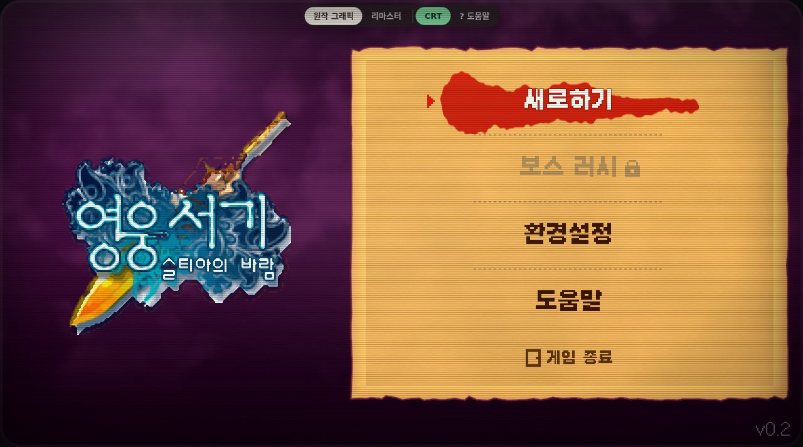
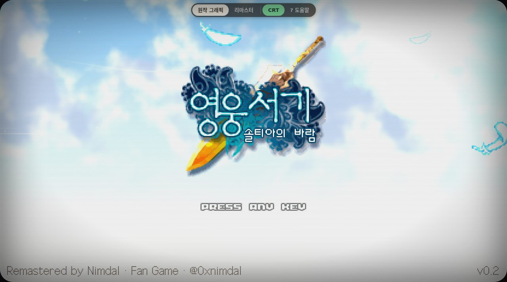
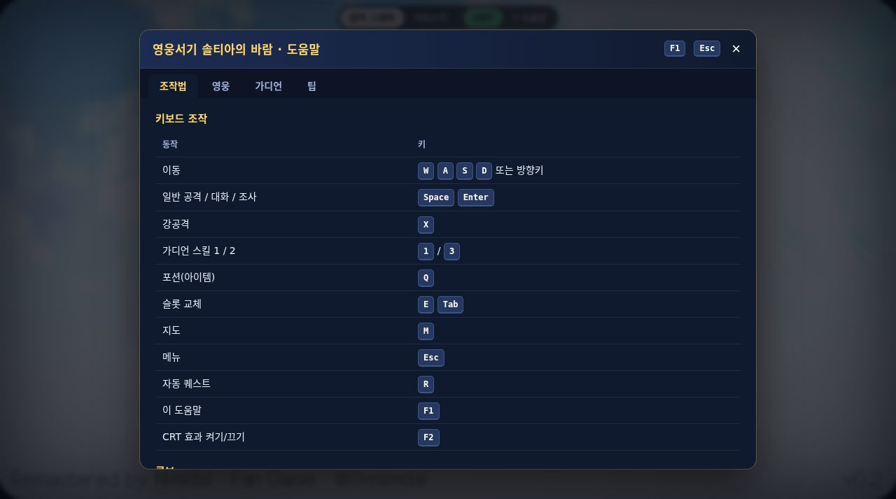
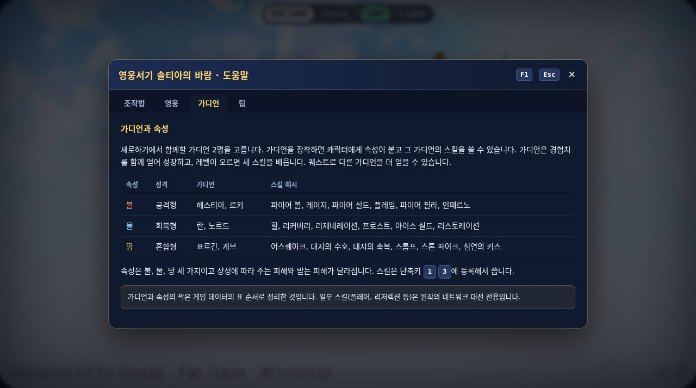
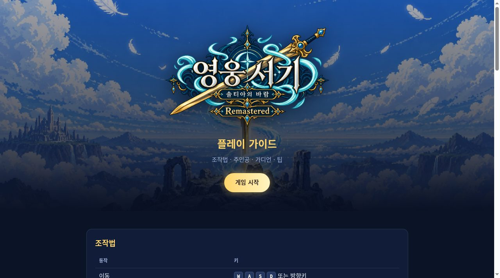

# 영웅서기 솔티아의 바람: 리마스터 · 웹 포크

> **▶ 바로 플레이: https://sigco3111.github.io/hero-lord-web/**
> 📖 플레이 가이드: https://sigco3111.github.io/hero-lord-web/guide.html



## 이 게임은 Nimdal 님의 작품입니다

〈영웅서기 솔티아의 바람: 리마스터〉는 **[Nimdal (@0xnimdal)](https://www.threads.com/@0xnimdal)** 님이 혼자 만든 안드로이드 앱입니다. 이 저장소는 [LESANF/hero-lord-web](https://github.com/LESANF/hero-lord-web)(앱을 브라우저에서 돌아가게 옮긴 도구 모음)을 포크해서, **게임 화면 바깥의 웹 페이지 부분**만 보태 본 것입니다. 게임의 그래픽, 사운드, 스크립트, 데이터, 기획에는 아무것도 손대지 않았습니다.

게임의 모든 권리는 원작자와 원작 〈영웅서기〉 권리자에게 있고, 이 저장소의 MIT 라이선스는 도구와 웹 페이지 코드에만 적용됩니다. 원작자나 권리자가 요청하면 이 배포는 내립니다.

## 이 포크에서 더한 것

| 기능 | 설명 |
|---|---|
| **CRT 효과** | 화면 위쪽의 `CRT` 버튼 또는 `F2`로 켜고 끕니다. 스캔라인, 가장자리 어두움, 둥근 모서리 베젤, 약한 빛 번짐. 선택은 브라우저에 기억되고 `?crt=1`로도 켜집니다. |
| **게임 안 도움말 (F1)** | `F1`이나 `? 도움말` 버튼으로 여는 패널. 조작법, 영웅, 가디언, 팁 네 탭. `Esc`로 닫고, 열려 있는 동안 게임에는 키가 전달되지 않습니다. |
| **한글 가이드 페이지** | [`guide.html`](https://sigco3111.github.io/hero-lord-web/guide.html). 같은 내용을 한 페이지로 정리했습니다. |

### CRT 효과

| 타이틀 | 메뉴 |
|---|---|
|  |  |

CSS 필터와 오버레이로 만든 효과라서 게임 성능에는 거의 영향이 없지만, 화면 전체를 다시 그리는 필터라 오래된 기기에서는 끄는 편이 낫습니다. 곡면 왜곡은 넣지 않았고, 둥근 모서리와 가장자리 어두움으로 곡면 느낌만 냈습니다. 빛 번짐도 실제 블룸 셰이더가 아니라 약한 글로우 필터입니다.

### 게임 안 도움말과 가이드

| 조작법 | 가디언 |
|---|---|
|  |  |



영웅과 가디언 정보는 게임 데이터(APK 안의 텍스트 표)에서 확인한 내용입니다. 가디언과 속성의 짝은 표의 순서로 정리했고, 플레어나 리저렉션처럼 원작의 네트워크 대전 전용인 스킬은 가이드에 그렇게 적어 두었습니다.

## 조작법

| 동작 | 키 |
|---|---|
| 이동 | `W` `A` `S` `D` / 방향키 |
| 일반 공격, 대화, 조사 | `Space` `Enter` |
| 강공격 | `X` |
| 가디언 스킬 1 / 2 | `1` / `3` |
| 포션(아이템) | `Q` |
| 슬롯 교체 | `E` `Tab` |
| 지도 | `M` |
| 메뉴 | `Esc` |
| 자동 퀘스트 | `R` |
| 도움말 | `F1` |
| CRT 효과 | `F2` |

화면의 조이스틱과 버튼은 원작 앱에 있던 것이고, 버튼 위에 작게 보이는 글자가 대응하는 키입니다.


## 원작 그래픽과 리마스터 그래픽

위쪽 스위치로 두 그림 세트를 바로 바꿀 수 있습니다. `?art=original` 또는 `?art=remaster`로 직접 지정할 수도 있습니다.

| 원작 그래픽 (2005, KTF) | 리마스터 그래픽 |
|---|---|
|  |  |

## 세이브

세이브는 이 브라우저의 IndexedDB에 저장됩니다. 타이틀의 환경설정에 있는 **세이브 내보내기 / 가져오기**로 다른 브라우저로 옮길 수 있습니다. 안드로이드 앱의 세이브와는 서로 옮길 수 없습니다.

## 작동 방식과 직접 빌드

APK에는 네이티브 게임 코드가 없고, 공식 Godot 4.6 런타임에 컴파일된 GDScript와 에셋이 들어 있습니다. 그래서 다시 쓰는 대신 APK를 풀어 PCK로 묶고 공식 웹 템플릿(WASM)에 얹어 정적 사이트로 만듭니다. 서버가 필요 없고 정적 호스팅이면 어디서든 돌아갑니다.

```
APK ─ 풀기 ─▶ Godot 프로젝트 ─ 묶기 ─▶ hero-lord.pck ─ 64MB씩 분할 ─▶ 정적 사이트
              + web/override.cfg + web/web_shim.gd (웹 전용 보정)
```

```sh
./build.sh hero-lord-remaster-20261014-r24.apk
python3 -m http.server -d build/web 8765     # http://127.0.0.1:8765/
```

- 이 포크에는 게임 파일이 들어 있지 않습니다. GitHub Actions(`.github/workflows/pages.yml`)가 배포할 때마다 **원작 저장소 Release `apk-r24`에서 APK를 내려받아** 빌드하고 GitHub Pages로 올립니다.
- 사이트 크기는 약 195MB(게임 데이터 157MB + 엔진 38MB)이고 첫 접속 때 전부 내려받습니다.
- 이 포크의 추가 코드는 모두 `web/index.html`(CRT, 도움말)과 `web/guide.html`에 있습니다. `tools/build_web.py`는 `guide.html`을 산출물에 넣도록 한 줄만 고쳤습니다.
- 원본 저장소의 분석 문서와 영문 README는 [`README.en.md`](README.en.md), [`docs/`](docs/)에 그대로 있습니다.

## 알려진 한계

- 도움말과 CRT는 데스크톱 브라우저에서 확인했습니다. 폰에서의 CRT 성능과 터치 동작은 직접 확인하지 못했습니다.
- 게임 로직은 컴파일된 스크립트라서 수정하지 않았습니다. 이 포크는 웹 페이지 레이어만 바꿉니다.
- 원본 저장소의 Release가 사라지면 이 포크의 빌드도 APK를 못 받아 실패합니다.

## 크레딧과 권리

- 게임: 〈영웅서기 솔티아의 바람: 리마스터〉 by **Nimdal** ([@0xnimdal](https://www.threads.com/@0xnimdal)), KTF 시절 원작의 팬 리마스터. 모든 그래픽, 사운드, 스크립트, 데이터는 원작자와 원작 〈영웅서기〉 권리자의 것이며 이 저장소의 라이선스 대상이 아닙니다. 원작자나 권리자가 요청하면 이 배포는 내립니다.
- 웹 포팅 도구: [LESANF/hero-lord-web](https://github.com/LESANF/hero-lord-web) (MIT).
- 엔진: [Godot Engine](https://godotengine.org) 4.6 (MIT).
- 이 포크의 추가분(CRT, 도움말, 가이드, 문서)은 MIT입니다.
